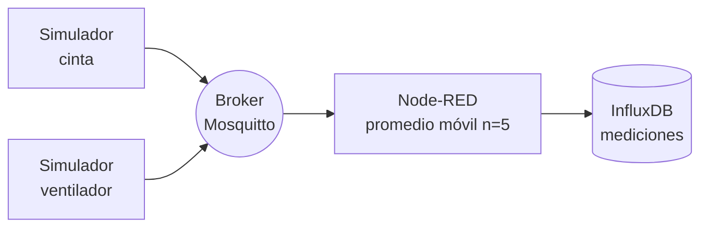
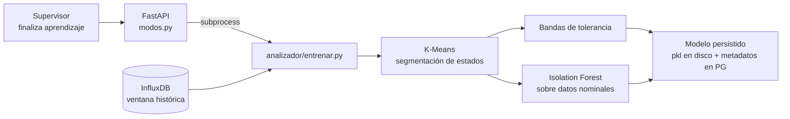
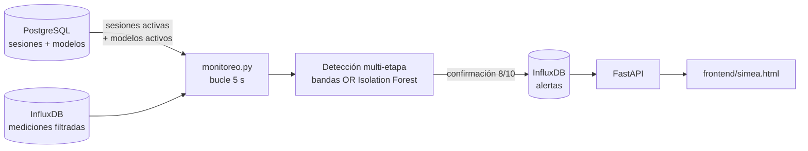

# Arquitectura del sistema

Este documento describe la arquitectura por capas del sistema SIMEA.

## Visión general

El sistema se organiza en seis capas desacopladas:

1. **Capa de generación de datos** — simuladores de equipos industriales que publican mediciones eléctricas.
2. **Capa de comunicación** — transporte por MQTT (broker Eclipse Mosquitto).
3. **Capa de adquisición y preprocesamiento** — Node-RED aplica filtrado estadístico y rutea las mediciones a la base temporal.
4. **Capa de almacenamiento** — InfluxDB para mediciones y alertas; PostgreSQL para metadatos y configuración.
5. **Capa de análisis** — servicio FastAPI con los módulos de entrenamiento (K-Means + Isolation Forest) y de monitoreo (detección multi-etapa).
6. **Capa de visualización** — interfaz web React single-file.

## Flujo de datos

El flujo del sistema se organiza en tres sub-flujos: preprocesamiento,
entrenamiento y monitoreo. Los tres comparten la capa de comunicación
(MQTT) y la capa de almacenamiento (InfluxDB para mediciones y
alertas, PostgreSQL para equipos, usuarios, modelos y sesiones).

### Preprocesamiento

Es un flujo continuo mientras los simuladores están publicando. Las
mediciones crudas de cada equipo se publican por MQTT, Node-RED
aplica un promedio móvil sobre una ventana de cinco muestras y
persiste la medición filtrada en InfluxDB, preservando el
identificador de equipo como etiqueta.

### Entrenamiento

Se dispara cuando el supervisor **finaliza** una sesión de
aprendizaje para un equipo determinado. En ese momento el endpoint
de la API lanza en segundo plano el script
`backend/analizador/entrenar.py` como subproceso. El script
consulta la ventana histórica correspondiente en InfluxDB, aplica
K-Means sobre las tres variables (potencia, corriente, factor de
potencia) para segmentar los estados operativos, calcula las
bandas de tolerancia y entrena un modelo de Isolation Forest sobre
los datos nominales. Los archivos del modelo se persisten en disco
dentro del contenedor del backend y sus metadatos quedan registrados
en PostgreSQL para que el supervisor los pueda activar desde la
interfaz.

### Monitoreo

Es un servicio independiente que corre en su propio contenedor en un
bucle de cinco segundos. En cada iteración consulta PostgreSQL para
descubrir equipos con sesión de monitoreo activa, carga de forma
diferida los modelos activos correspondientes y procesa las
mediciones filtradas recientes de cada equipo. La detección
combina las bandas de tolerancia y el Isolation Forest con lógica
OR; una anomalía se confirma sólo si al menos 8 de las últimas 10
muestras evaluadas resultaron anómalas. Las alertas confirmadas se
publican en InfluxDB con severidad y firma, y la interfaz web las
consulta a través de la API.

## Multi-equipo

El sistema soporta múltiples equipos simultáneamente. Cada equipo dispone de su propio flujo de datos identificado desde la generación, su propio modelo entrenado, su propio conjunto de alertas y puede ser operado de forma independiente respecto a los demás. La propagación del identificador de equipo se mantiene a lo largo de toda la cadena.

## Detalle completo

Para el detalle completo de la arquitectura, consultar el documento de tesis asociado al proyecto.
